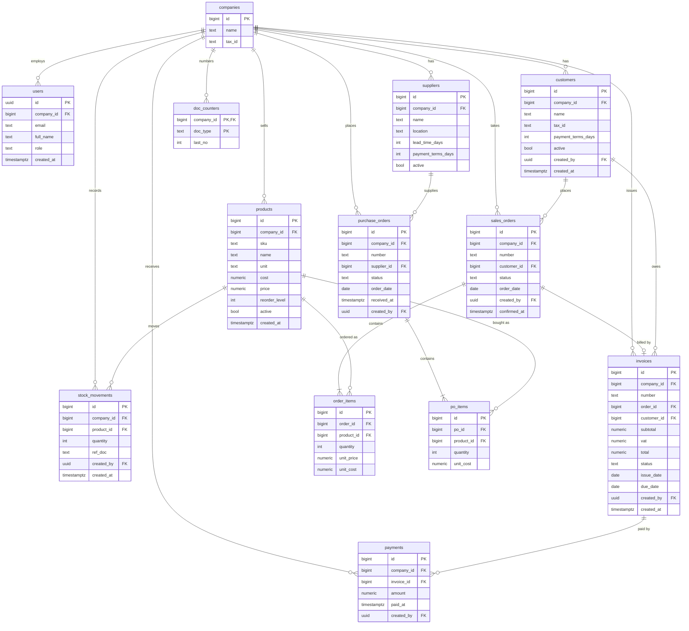

# Siam Bean Mini ERP

A small cloud ERP for Siam Bean Co., a Bangkok coffee-bean distributor:
sales orders, stock, invoices with 7% VAT, payments and a live dashboard,
in one database with role-based login.

**Live app:** https://siam-bean-erp.pages.dev
**API:** https://siam-bean-erp.onrender.com/health

The API runs on Render's free tier and sleeps after about 15 minutes idle, so
the first request can take up to a minute. Open `/health` first.

## Demo accounts

| Role | Email |
| --- | --- |
| Admin | punji@gmail.com |
| Sales | ana@gmail.com |
| Sales | bogie@gmail.com |
| Warehouse | gap@gmail.com |
| Accountant | jump@gmail.com |

The demo password is shared by the team and is not written in this repo.
Each role sees only its own menu; anything else answers 403 and shows an
access-denied page.

## User stories

| Story | Status |
| --- | --- |
| US-1 Sales order to invoice: Café Lune's 20 kg ARB-1KG order becomes `INV-0001` for 9,630.00 THB and leaves 150 kg; too little stock shows "Not enough stock for ARB-1KG" and changes nothing | Done |
| US-2 Low stock: ROB-1KG shows a low-stock badge on the product list and is counted on the dashboard | Done |
| US-3 Roles: Sales gets 403 and the access-denied page on Accounting; Warehouse gets 403 on confirm; Admin loads everything | Done |
| US-4 Payment: paying `INV-0001` in full makes it Paid and drops dashboard receivables by 9,630.00 THB | Done |
| US-5 Customer search: name search over 200 customers, at most 20 per page | Done |

Each story is covered by API tests in `backend/tests/`. `tests/test_cafe_lune.py`
runs US-1, US-3 and US-4 as one Café Lune flow.

## Bonus

| Feature | Status | How to see it |
| --- | --- | --- |
| Purchasing: PO to goods receipt to stock in | Done | Log in as Warehouse (gap@gmail.com) or Admin, Purchase orders: create `PO-0001`, then Receive it and see stock on hand rise on Products |
| PDF invoice | Done | Log in as Sales, Accountant or Admin, open any invoice, Download PDF (saves `INV-0001.pdf`) |

## User management

Log in as Admin and open **Users**: the list shows every employee with
their role. **Add user** takes an email, full name, role and a temporary
password, and the employee can log in straight away (no confirmation email).
Change anyone's role with the dropdown on their row; an admin cannot change
their own role. Only Admin may use this page and its API (`/users`).

## Who did what

| Part | Name | Student ID | Module | Tickets |
| --- | --- | --- | --- | --- |
| Part 1 | | | Products, customers, dashboard, purchasing (bonus) | 04–09, 18, 20, 21 |
| Part 2 | | | Sales orders, confirm to invoice, invoices, accounting and payments, stock in, PDF invoice (bonus) | 10, 11, 13–17, 22 |
| Part 3 | | | Foundation, login and roles, auth hardening, deploy | 01–03, 19, 23 |

Part 2 took over tickets 16 and 17 from Part 3, and ticket 13 from Part 1.

## Stack

- **Database and login:** Supabase (Postgres + Auth).
- **Backend:** Python 3.12, FastAPI, managed with uv, on Render. Talks to
  Supabase with the secret key. Invoice PDFs are made with fpdf2.
- **Frontend:** React + TypeScript + Vite on Node 22, on Cloudflare Pages.
  Uses Supabase only to log in (publishable key) and calls the API with the
  user's token.

Business rules that must be all-or-nothing (create an order, confirm an
order to an invoice, record a payment, receive a PO) run as Postgres
functions in `docs/schema.sql`. FastAPI checks the role on every endpoint
(wrong role = 403).

## Setup

1. Create a Supabase project. In the SQL Editor run `docs/schema.sql`, then
   `docs/seed.sql`. Create the demo users under Authentication, then run
   `docs/demo_users.sql`. It adds the `@example.com` users that the tests log
   in as. The demo accounts above were added to the `users` table the same
   way, but they are not in the repo's SQL.
2. Backend (http://localhost:8000):
   ```bash
   cd backend
   cp .env.example .env      # fill in SUPABASE_URL and SUPABASE_SECRET_KEY
   uv sync
   uv run uvicorn app.main:app --reload
   ```
3. Frontend (http://localhost:5173):
   ```bash
   cd frontend
   cp .env.example .env      # fill in the three VITE_ values
   npm install
   npm run dev
   ```
4. Tests:
   ```bash
   cd backend
   cp .env.example .env.test # same Supabase project as .env
   uv run pytest
   ```
   The tests use the same Supabase project as the app and reset its data
   before every test, so they wipe every order, invoice, payment and stock
   movement. Never run them during the demo. Before the demo, run
   `select reset_demo_data('yes-reset');` in the SQL Editor.

Deploy settings (Render and Cloudflare Pages) are in `docs/plan.md`.

## Database schema



Every `created_by` is the `users` row that made the record; those lines are
left out to keep the diagram readable. `create_order` adds no tables: it
inserts a `sales_orders` row and its `order_items`, numbered from
`doc_counters`.

Stock on hand is the `stock_on_hand` view: the sum of `stock_movements` per
product. Nobody types a stock number.

## Docs

`docs/scenario.md` (brief), `docs/plan.md` (decisions), `GLOSSARY.md`,
spec and tickets in `.scratch/`.
