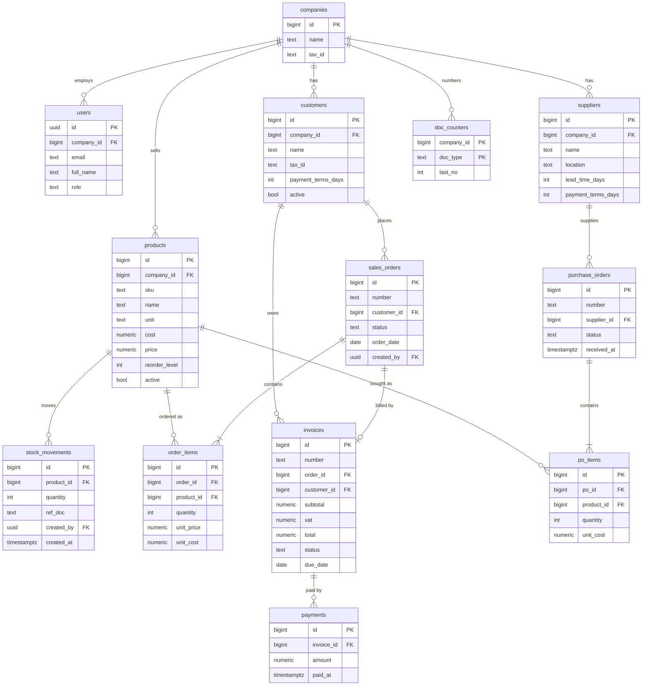

# Siam Bean Mini ERP

A small cloud ERP for Siam Bean Co., a Bangkok coffee-bean distributor:
sales orders, stock, invoices with 7% VAT, payments and a live dashboard,
in one database with role-based login.

**Live app:** https://YOUR-APP.pages.dev
**API:** https://YOUR-API.onrender.com/health

## Demo accounts

| Role | Email | Password |
| --- | --- | --- |
| Admin (Khun Somchai) | somchai@example.com | (demo password) |
| Sales (Nok) | nok@example.com | (demo password) |
| Sales (Ploy) | ploy@example.com | (demo password) |
| Warehouse (Lek) | lek@example.com | (demo password) |
| Accountant (Fon) | fon@example.com | (demo password) |

## User stories

| Story | Status |
| --- | --- |
| US-1 Sales order to invoice | Done / Not done |
| US-2 Low stock | Done / Not done |
| US-3 Roles | Done / Not done |
| US-4 Payment | Done / Not done |
| US-5 Customer search | Done / Not done |

## Bonus

| Feature | Status | How to see it |
| --- | --- | --- |
| Purchasing: PO to goods receipt to stock in | Done / Not done | Log in as Lek, Purchase orders |
| PDF invoice | Done / Not done | Any invoice, Download PDF |

## Who did what

| Member | Student ID | Module | GitHub |
| --- | --- | --- | --- |
| | | Foundation, login and roles, payments, dashboard, deploy | |
| | | Products, customers, stock, purchasing | |
| | | Sales orders, confirm to invoice, invoices, PDF | |
| | | Presentation | |
| | | Presentation | |

## Stack

Supabase (Postgres + Auth), FastAPI with uv (Render), React + TypeScript +
Vite (Cloudflare Pages). Business rules that must be all-or-nothing run as
Postgres functions (`docs/schema.sql`), and FastAPI checks the role on every
endpoint (wrong role = 403).

## Setup

1. Create a Supabase project. In the SQL Editor run `docs/schema.sql`, then
   `docs/seed.sql`. Create the demo users under Authentication, then run
   `docs/demo_users.sql`.
2. Backend:
   ```bash
   cd backend
   cp .env.example .env      # fill in SUPABASE_URL and SUPABASE_SECRET_KEY
   uv sync
   uv run uvicorn app.main:app --reload
   ```
3. Frontend:
   ```bash
   cd frontend
   cp .env.example .env      # fill in the three VITE_ values
   npm install
   npm run dev
   ```
4. Tests (use a separate test Supabase project in `backend/.env.test`):
   ```bash
   cd backend
   uv run pytest
   ```

## Database schema



Stock on hand is the `stock_on_hand` view: the sum of `stock_movements` per
product. Nobody types a stock number.

## Docs

`docs/scenario.md` (brief), `docs/plan.md` (decisions), `GLOSSARY.md`,
spec and tickets in `.scratch/`.
